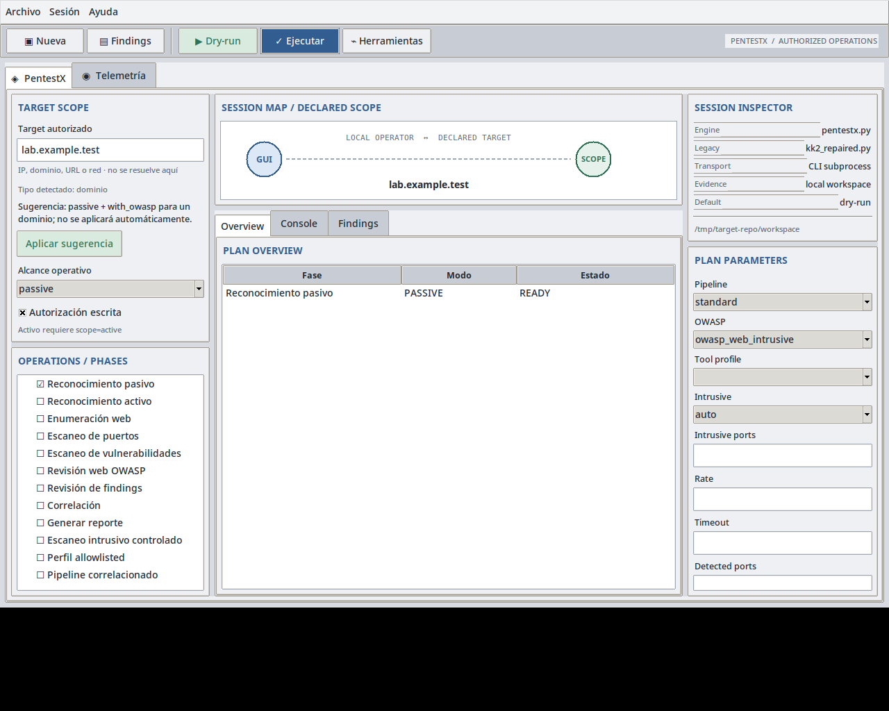
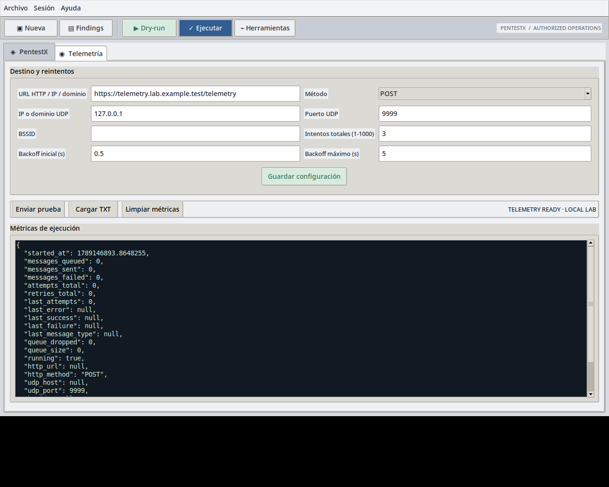

# PentestX autorizado

**Estación local para planificar, ejecutar y documentar evaluaciones de seguridad autorizadas.** El módulo legado está archivado en `archive/kk2_legacy.py` y nunca se ejecuta; PentestX añade una capa CLI con controles de alcance y autorización, y ofrece una GUI de escritorio basada en Tkinter/ttk. La GUI también integra un panel independiente de telemetría para destinos HTTP/UDP, reintentos y métricas.

> **Uso obligatorio:** trabaja únicamente sobre activos propios o cubiertos por autorización escrita y reglas de compromiso vigentes. La confirmación de la interfaz no sustituye la autorización del propietario.

## Nivel 1 — reparación de seguridad (2026-11-13)

1. **Legado archivado:** `kk2_repaired.py` (Hydra con credenciales en texto plano, John/Hashcat, Metasploit con `exec(code)`, escaneos agresivos, exfiltración y borrado de logs) se movió a `archive/kk2_legacy.py` con aviso. `pentestx.py` no lo importa ni lo carga: `load_legacy()` lanza `RuntimeError` si algo intenta usarlo.
2. **Pipelines controlados:** `standard`/`with_intrusive`/`with_owasp`/`full_web` solo usan pasos controlados (passive local, active `nmap -sn --max-rate 5`, intrusive `nmap -sT -sV` acotado, OWASP web GET/HEAD con topes, vulnerability/correlate/report locales). No existe ningún paso que invoque el legado; el modo real sin perfil controlado se niega.
3. **Alcance con `scope.yaml`:** por defecto solo `contaia.site` y `127.0.0.1`. Se rechazan redes privadas, `169.254.169.254`, `0.0.0.0/0`, redes más amplias que /24, multicast y loopback distinto de `127.0.0.1`. Toda acción con target exige `--authorization-reference` (ruta o identificador del documento de autorización escrita).
4. **Dry-run en la GUI:** botón «Ver plan (dry-run)» que muestra el comando exacto y lo ejecuta en modo dry-run; la ejecución real se niega hasta haber revisado el plan para ese comando exacto.
5. **`ffuf_safe` practicable:** wordlist propia de 200 entradas (`wordlists/ffuf_safe_200.txt`) y `max_requests: 200` explícito; una wordlist mayor que el tope se rechaza.
6. **Evidencia protegida:** `workspace/` en `.gitignore`; los cuerpos de respuesta se guardan solo como extracto de 1.024 caracteres con SHA-256; credenciales redactadas en texto y en estructuras (`redact_text`/`redact_value`, incluido `Authorization: Bearer <token>`); el escaneo OWASP se detiene ante 429/403.
7. **Licencia, tests y CI:** licencia MIT (`LICENSE`), tests en `tests/` (`python3 -m unittest discover -s tests -v`, solo mocks y dry-run, sin herramientas externas) y CI en `.github/workflows/ci.yml`.

**Fuera del nivel 1:** la telemetría (`telemetry_sender.py` y el panel de la GUI) sigue sin cifrado ni autenticación — solo destinos de laboratorio y sin secretos en el código.

## Vista general

La aplicación se organiza en dos paneles separados por pestañas. **◈ PentestX** contiene el planificador de operaciones, findings, pipelines y consola. **◉ Telemetría** contiene exclusivamente la configuración del emisor integrado desde `kali-telemetry-gui`.



*Panel principal con target sintético de laboratorio, fases, mapa de sesión, plan e inspector.*



*Panel de telemetría con HTTP, UDP, reintentos, backoff y métricas. Las capturas son demostrativas y no representan una ejecución real.*

## Inicio rápido

### Dependencias

En Kali Linux o una distribución Debian/Ubuntu instala Python, Tkinter y las herramientas básicas:

```bash
sudo apt update
sudo apt install -y python3 python3-tk coreutils
```

PyYAML es opcional y solo se necesita para políticas YAML:

```bash
python3 -m pip install -r requirements.txt
```

### Abrir la interfaz gráfica

```bash
python3 pentestx_gui.py
```

### Abrir la CLI

```bash
python3 pentestx.py --help
python3 pentestx.py --interactive
```

La interfaz gráfica muestra el plan y solicita autorización y confirmación antes de ejecutar una operación.

## Tutorial paso a paso

### 1. Preparar el alcance

En la pestaña **◈ PentestX**, introduce una IP, dominio, URL o red CIDR que esté dentro del alcance autorizado. La GUI clasifica el valor localmente, sin resolverlo ni contactar la red. Puede sugerir un pipeline o perfil según el tipo de target; la sugerencia no se aplica hasta pulsar **Aplicar sugerencia**.

Marca **Autorización escrita** solo cuando la autorización exista y cubra el target. Para fases activas, selecciona `active` en el alcance operativo. Las acciones activas no pueden ejecutarse con `scope=passive`.

### 2. Seleccionar fases

En **OPERATIONS / PHASES**, activa las fases necesarias. La tabla **PLAN OVERVIEW** permite revisar el modo de cada fase antes de iniciar:

| Grupo | Fases disponibles |
|---|---|
| Reconocimiento | `passive`, `active` |
| Enumeración y revisión | `web`, `ports`, `vuln`, `owasp_web`, `vulnerability` |
| Correlación y salida | `correlate`, `report`, `correlated` |
| Perfiles controlados | `tool`, `intrusive` |

Las acciones `tool` requieren perfiles allowlisted. El escaneo `intrusive` usa perfiles limitados, puertos, tasa, timeout y exclusiones validadas por la CLI.

### 3. Aplicar sugerencias de target o puertos

El inspector derecho puede sugerir parámetros según el target y los puertos detectados en un `findings_db.json` local. **Analizar puertos** solo lee datos locales; no ejecuta Nmap ni consulta servicios. **Aplicar regla** modifica el pipeline o el campo de puertos, pero no ejecuta nada.

Las reglas distinguen HTTP/HTTPS, SSH, FTP/FTPS, SMTP, POP3/IMAP, SMB/NFS, DNS, MySQL, PostgreSQL, Redis y otros servicios comunes. Para bases de datos, correo, acceso remoto y compartición, las recomendaciones son pasivas y no habilitan credenciales, fuerza bruta, extracción ni comandos.

### 4. Validar un plan con la CLI

Para generar un manifiesto sin tráfico, usa la CLI:

```bash
python3 pentestx.py \
  --target example.com \
  --scope passive \
  --action passive correlate report \
  --confirm-written-authorization \
  --dry-run
```

El resultado esperado incluye `DRY-RUN: no se ejecutarán funciones ni tráfico de red.` y un `execution_manifest.json` bajo `workspace/pentestx_sessions/<timestamp>/`.

### 5. Ejecutar un plan autorizado

Para ejecutar desde la GUI, revisa el plan, el target, el scope, los puertos, las exclusiones y la autorización; después pulsa **Ejecutar** y acepta la confirmación. La CLI también exige `--scope active` y `--confirm-written-authorization` para las acciones activas.

Ejemplo de previsualización de un pipeline controlado:

```bash
python3 pentestx.py \
  --target 192.0.2.10 \
  --scope active \
  --action correlated \
  --pipeline-profile with_intrusive \
  --intrusive-profile auto \
  --confirm-written-authorization \
  --dry-run
```

### 6. Usar la pestaña Telemetría

Cambia a **◉ Telemetría**. Configura una URL HTTP `GET`/`POST` o un destino UDP, define puerto, BSSID contextual, intentos totales y backoff. Pulsa **Guardar configuración** y después **Enviar prueba** para encolar un mensaje sintético. **Cargar TXT** lee un archivo local de hasta 1 MiB y lo trata como datos; no ejecuta sus líneas.

El panel muestra mensajes encolados, envíos, fallos, intentos, reintentos, errores recientes y tamaño de cola. UDP no cifra ni confirma que la aplicación remota haya procesado el datagrama. Usa solo receptores controlados y prefiere HTTPS cuando esté disponible.

## Seguridad y límites

PentestX no expone desde su capa CLI ni desde la GUI funciones de fuerza bruta, explotación personalizada, post-explotación, persistencia en el target, pivoting o exfiltración. La fase `vulnerability` procesa findings existentes y produce candidatos para revisión manual; no autoriza explotación.

El panel de telemetría es independiente del panel de PentestX. Cambiar de pestaña no inicia un plan ni envía datos automáticamente. El cierre de la ventana detiene el worker de telemetría.

La persistencia de la aplicación se limita a evidencia local, logs, manifiestos, capturas hashadas y reportes del workspace. No se crea persistencia en los activos evaluados.

## CLI, perfiles y políticas

Lista los perfiles fijos y personalizados:

```bash
python3 pentestx.py --list-profiles
python3 pentestx.py --policy-file profiles.example.yaml --list-profiles
```

Los perfiles fijos `ffuf_safe` y `sqlmap_safe` usan allowlists, límites de tasa, concurrencia, timeout, reintentos y categorías de findings compatibles. La instalación de herramientas está separada de la ejecución y permite únicamente paquetes allowlisted:

```bash
python3 pentestx.py \
  --profile ffuf_safe \
  --install-tools \
  --confirm-tool-install
```

La política OWASP web está documentada en [`OWASP_WEB_FINDINGS_PIPELINES.md`](OWASP_WEB_FINDINGS_PIPELINES.md). Los ejemplos se encuentran en [`profiles.example.yaml`](profiles.example.yaml) y [`owasp_profiles.example.yaml`](owasp_profiles.example.yaml).

## Salidas y evidencia

Cada sesión genera un workspace local. Según las fases seleccionadas puede contener `execution_manifest.json`, `findings_db.json`, `attack_chains.json`, logs por módulo, reportes, `vulnerability_review.json`, `VULNERABILITY_REVIEW.md`, manifiestos de perfiles, artefactos de escaneo intrusivo y capturas con SHA-256.

La estructura visual de la GUI se explica con mayor detalle en [`GUI_TUTORIAL.md`](GUI_TUTORIAL.md). La captura de referencia del diseño anterior está en [`docs/screenshots/pentestx-gui-ettercap-model.png`](docs/screenshots/pentestx-gui-ettercap-model.png).

## Comprobación y desarrollo

Ejecuta las comprobaciones básicas:

```bash
python3 -m py_compile pentestx_gui.py telemetry_sender.py pentestx.py pentestx_controlled.py
python3 -m unittest discover -s tests -v
python3 pentestx.py --check-tools
# Dry-run contra contaia.site (requiere scope.yaml y referencia de autorización;
# copia scope.example.yaml a scope.yaml y completa la referencia):
python3 pentestx.py --target https://contaia.site \
  --scope active \
  --action correlated \
  --pipeline-profile standard \
  --confirm-written-authorization \
  --authorization-reference docs/AUTORIZACION-contaia.md \
  --scope-file scope.yaml \
  --dry-run
```

La validación histórica y la matriz de pruebas están en [`VALIDATION.md`](VALIDATION.md).

## Estructura del proyecto

| Archivo o directorio | Propósito |
|---|---|
| `pentestx_gui.py` | GUI principal con pestañas PentestX y Telemetría. |
| `telemetry_sender.py` | Emisor asíncrono HTTP/UDP integrado desde el repo de telemetría. |
| `pentestx.py` | Capa CLI, validaciones, límites, pipelines y manifiestos. |
| `pentestx_controlled.py` | Alcance (`Scope`/`scope.yaml`), sesiones, pasos controlados y redacción de evidencia. |
| `archive/kk2_legacy.py` | Módulo legado archivado; nunca se ejecuta. |
| `scope.example.yaml` | Alcance de ejemplo (copiar a `scope.yaml`). |
| `wordlists/ffuf_safe_200.txt` | Wordlist de 200 entradas para el perfil `ffuf_safe`. |
| `tests/` | Tests automatizados de nivel 1 (unittest, mocks y dry-run). |
| `.github/workflows/ci.yml` | CI: compila los módulos y corre los tests. |
| `GUI_TUTORIAL.md` | Tutorial extendido de interfaz, sugerencias y telemetría. |
| `docs/screenshots/` | Capturas visuales de los paneles. |
| `workspace/` | Evidencia y sesiones generadas localmente. |

## Estado y licencia

El proyecto es experimental y está orientado a laboratorios y activos autorizados. Revisa [`CHANGELOG.md`](CHANGELOG.md), [`SECURITY.md`](SECURITY.md) y las reglas de compromiso antes de usarlo. Licencia MIT, ver [`LICENSE`](LICENSE).

Repositorio: [hubgunter4-ops/n](https://github.com/hubgunter4-ops/n)
